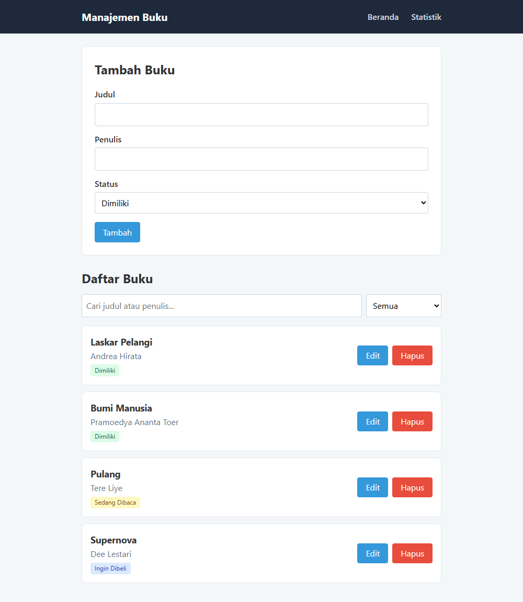
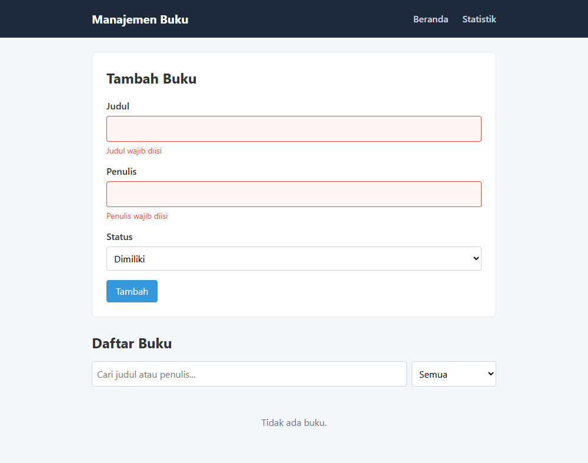
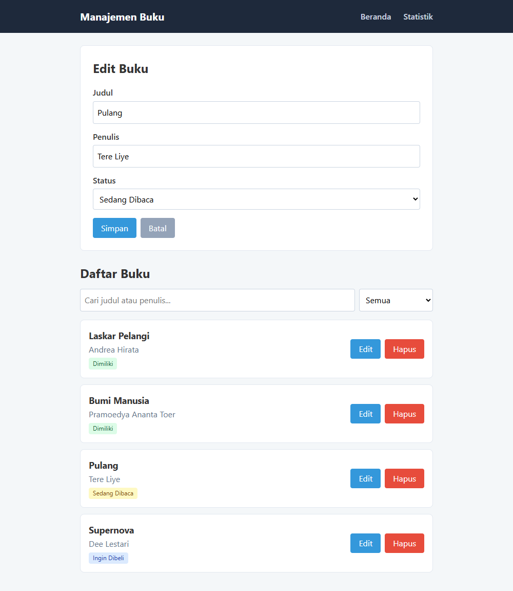
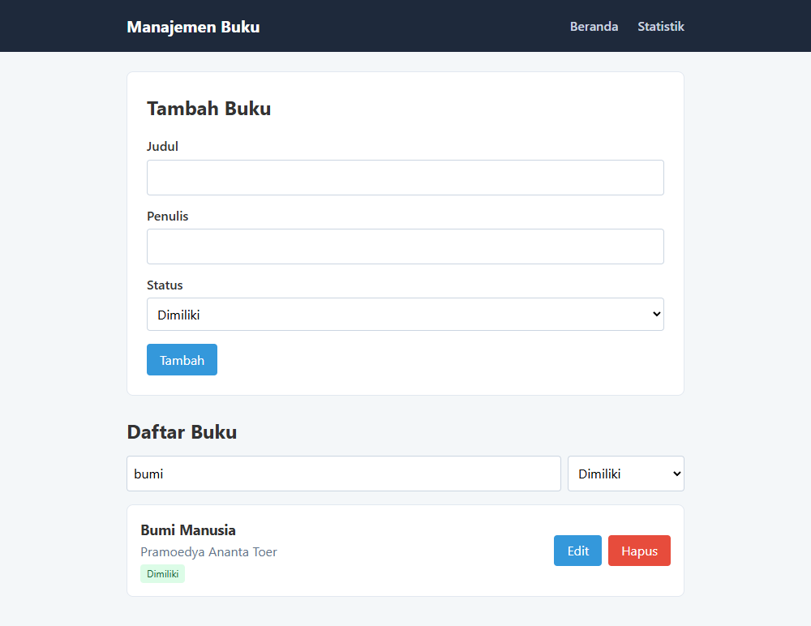
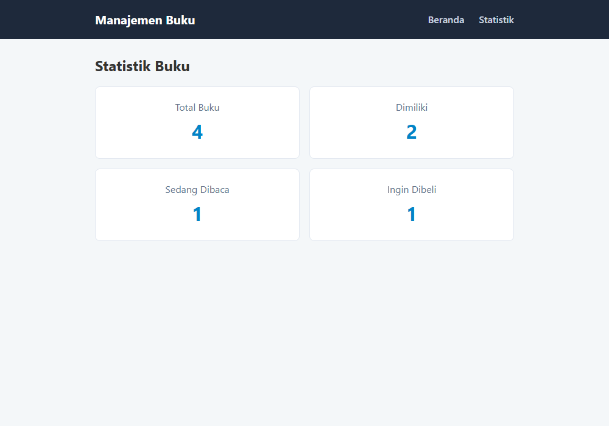
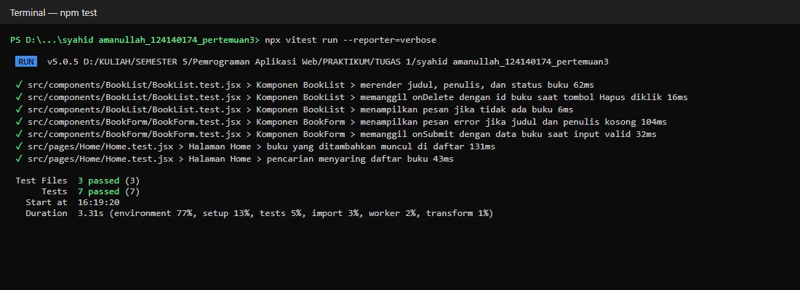

# 📚 Aplikasi Manajemen Buku Pribadi

Tugas Praktikum Pemrograman Aplikasi Web — Pertemuan 3

| | |
|---|---|
| **Nama** | Syahid Amanullah |
| **NIM** | 124140174 |
| **Kelas** | RA |

---

## 📖 Deskripsi Aplikasi

Aplikasi sederhana berbasis **React** untuk mencatat buku pribadi. Setiap buku punya **judul**, **penulis**, dan **status**:

- **Dimiliki** (`milik`)
- **Sedang Dibaca** (`baca`)
- **Ingin Dibeli** (`beli`)

Fitur:
- Menambah buku baru
- Mengedit dan menghapus buku
- Filter buku berdasarkan status
- Pencarian buku berdasarkan judul atau penulis
- Halaman statistik (jumlah buku per status)
- Data tersimpan di **localStorage**, jadi tidak hilang saat halaman di-refresh
- Validasi form: judul dan penulis wajib diisi; input yang kosong diberi border merah dan pesan error

---

## 🚀 Instalasi & Cara Menjalankan

Prasyarat: Node.js dan npm sudah terpasang.

```bash
# 1. Masuk ke folder project
cd "syahid amanullah_124140174_pertemuan3"

# 2. Install dependensi
npm install

# 3. Jalankan aplikasi
npm run dev
```

Buka `http://localhost:5173` di browser.

Menjalankan unit test:

```bash
npm test
```

---

## 🖼️ Screenshot

**Halaman Beranda**



**Validasi form (input kosong)**



**Edit buku**



**Filter status + pencarian**



**Halaman Statistik**



---

## ⚛️ Fitur React yang Digunakan

| Fitur | Penjelasan |
|---|---|
| **Functional Components & Hooks** | Semua komponen dibuat sebagai fungsi. |
| **useState** | Menyimpan isi form, pesan error, kata kunci pencarian, filter status, dan buku yang sedang diedit. |
| **useEffect** | Di `useLocalStorage`: menyimpan data ke localStorage setiap kali berubah. Di `BookForm`: mengisi form saat tombol Edit diklik. |
| **Komponen reusable** | `Navbar`, `BookForm`, `BookList`, `BookFilter` |
| **Custom Hook** | `useLocalStorage` (state yang tersimpan di localStorage) dan `useBookStats` (menghitung jumlah buku per status). |
| **Context API** | `BookContext` menyimpan daftar buku beserta fungsi `addBook`, `updateBook`, dan `deleteBook`. Halaman cukup memanggil `useBooks()`, tanpa perlu mengoper props. |
| **React Router** | Dua halaman: `/` (Beranda) dan `/stats` (Statistik). |
| **PropTypes** | Mengecek tipe props di setiap komponen. |

### Struktur Folder

```
src/
├── components/
│   ├── BookFilter/   (BookFilter.jsx, BookFilter.css)
│   ├── BookForm/     (BookForm.jsx, BookForm.css, BookForm.test.jsx)
│   ├── BookList/     (BookList.jsx, BookList.css, BookList.test.jsx)
│   └── Navbar/       (Navbar.jsx, Navbar.css)
├── pages/
│   ├── Home/         (Home.jsx, Home.css, Home.test.jsx)
│   └── Stats/        (Stats.jsx, Stats.css)
├── hooks/
│   ├── useLocalStorage.js
│   └── useBookStats.js
├── context/
│   └── BookContext.jsx
├── utils/
│   └── constants.js
├── App.jsx
├── App.css
├── main.jsx
└── setupTests.js
```

---

## 🧪 Laporan Testing

Unit test menggunakan **Vitest + React Testing Library**, dengan total **7 test**:

| File | Test |
|---|---|
| `BookForm.test.jsx` | Pesan error muncul jika judul/penulis kosong; `onSubmit` terpanggil dengan data yang benar |
| `BookList.test.jsx` | Judul, penulis, dan status tampil; tombol Hapus memanggil `onDelete`; pesan "Tidak ada buku." muncul jika daftar kosong |
| `Home.test.jsx` | Buku yang ditambahkan muncul di daftar; pencarian menyaring daftar |

Hasil `npm test`: **7 dari 7 test lulus**.


