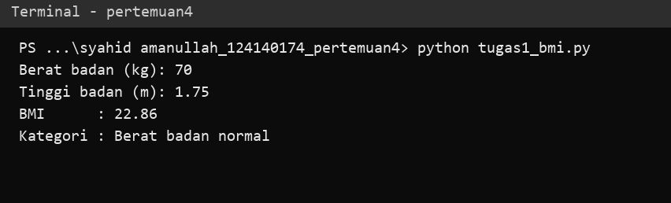
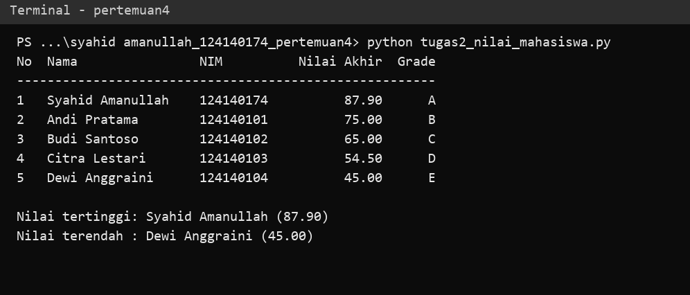
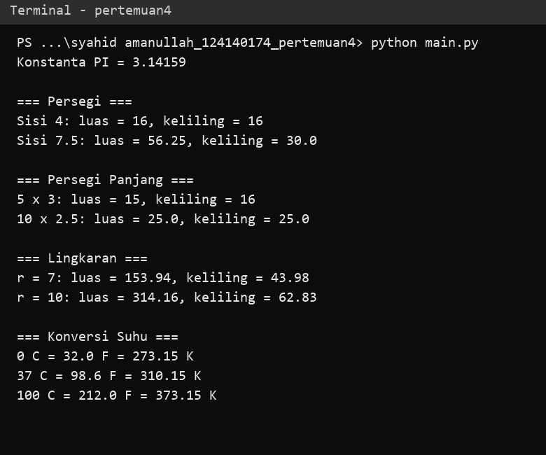

# Tugas Praktikum PAW — Pertemuan 4 (Python Dasar)

| | |
|---|---|
| **Nama** | Syahid Amanullah |
| **NIM** | 124140174 |
| **Kelas** | RA |

## Cara Menjalankan

Prasyarat: Python 3.8+. Jalankan dari folder ini (VS Code terminal):

```bash
python tugas1_bmi.py
python tugas2_nilai_mahasiswa.py
python main.py
```

## Soal 1 — Penghitung BMI (`tugas1_bmi.py`)

Alur: input berat (kg) dan tinggi (m) lewat `input()` → `hitung_bmi()` menghitung `berat / (tinggi * tinggi)` → `kategori_bmi()` memakai `if-elif-else` (<18.5 kurang, <25 normal, <30 berlebih, selain itu obesitas) → hasil dicetak dengan f-string 2 desimal.



## Soal 2 — Nilai Mahasiswa (`tugas2_nilai_mahasiswa.py`)

Alur: list berisi 5 dictionary (`nama`, `nim`, `nilai_uts`, `nilai_uas`, `nilai_tugas`) → `hitung_nilai_akhir()` (30% UTS + 40% UAS + 30% Tugas) → `tentukan_grade()` (A–E) → tabel dicetak dengan alignment f-string → `max()` dan `min()` dengan `lambda` mencari nilai tertinggi dan terendah.



## Soal 3 — Modul Matematika (`math_operations.py` + `main.py`)

- `math_operations.py`: konstanta `PI`, luas & keliling persegi, persegi panjang, lingkaran, serta konversi suhu Celsius→Fahrenheit dan Celsius→Kelvin.
- `main.py`: memakai dua gaya import (`import math_operations` dan `from math_operations import ...`) lalu memanggil semua fungsi dengan beberapa input.


