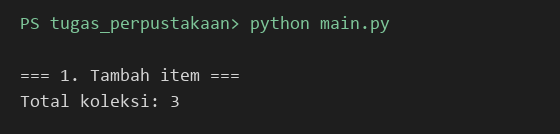
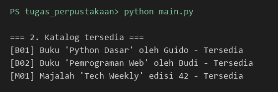
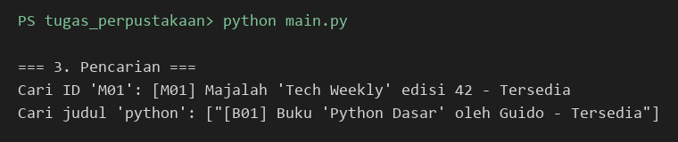
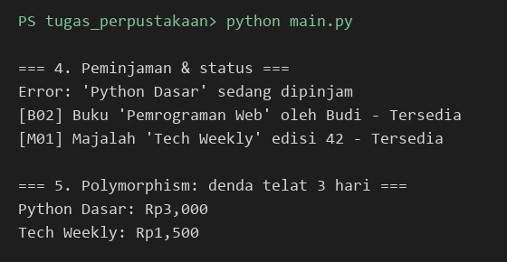

# Tugas Praktikum Pemrograman Aplikasi Web — Pertemuan 5 (Python OOP)

| | |
|---|---|
| **Nama** | Syahid Amanullah |
| **NIM** | 124140174 |
| **Kelas** | RA |

## Deskripsi Program

Sistem Manajemen Perpustakaan Sederhana (`tugas_perpustakaan/`). Alur `main.py`:
tambah item → tampilkan katalog → cari berdasarkan ID/judul → pinjam item dan cek status → hitung denda.

Penerapan empat pilar OOP:

- **Class** — `LibraryItem`, `Book`, `Magazine`, `Member`, dan `Library` masing-masing membungkus data dan perilakunya sendiri.
- **Inheritance** — `Book` dan `Magazine` mewarisi `LibraryItem` (`super().__init__`), sehingga `item_id`, `judul`, dan status pinjam tidak ditulis ulang.
- **Encapsulation** — `__dipinjam` (di `LibraryItem`), `__koleksi` (di `Library`), dan `__pinjaman` (di `Member`) bersifat private; `_judul`, `_penulis`, `_edisi` protected. Akses lewat `@property`, dan setter `is_dipinjam` memvalidasi tipe `bool`. `Member.pinjaman` mengembalikan salinan agar daftar aslinya tidak bisa diubah dari luar.
- **Polymorphism** — `LibraryItem` adalah abstract class dengan abstract method `get_detail()` dan `hitung_denda()`. Tiap subclass mengimplementasikannya berbeda (denda buku Rp1.000/hari, majalah Rp500/hari), dan `Library` memperlakukan semua item lewat tipe dasar yang sama.

### Struktur

```
latihan/               # 7 latihan hands-on (satu konsep per file)
tugas_perpustakaan/
├── library_item.py    # LibraryItem (ABC), Book, Magazine
├── member.py          # Member (pinjam & kembalikan)
├── library.py         # Library (tambah, tampilkan, cari)
└── main.py            # skrip uji
```

## Cara Menjalankan

Butuh Python 3.10+.

```bash
cd tugas_perpustakaan
python main.py
```

Latihan dijalankan satu per satu, contoh: `python latihan/03_inheritance.py`.

## Screenshot Output

Hasil `python main.py` pada folder `tugas_perpustakaan`.

**1. Menambahkan item** — 2 buku dan 1 majalah ditambahkan ke koleksi.



**2. Menampilkan katalog** — semua item yang tersedia.



**3. Pencarian** — berdasarkan ID (`M01`) dan judul (`python`).



**4. Status ketersediaan dan polymorphism** — buku yang dipinjam hilang dari daftar tersedia, meminjam ulang menghasilkan error, dan `hitung_denda()` berbeda tiap jenis item.


