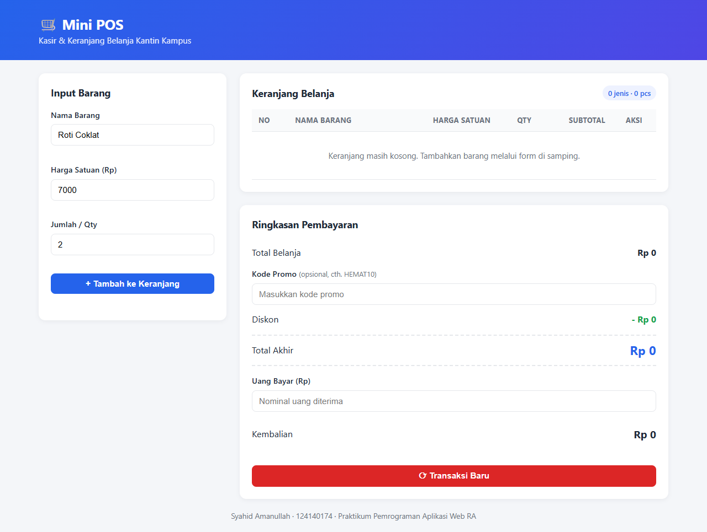
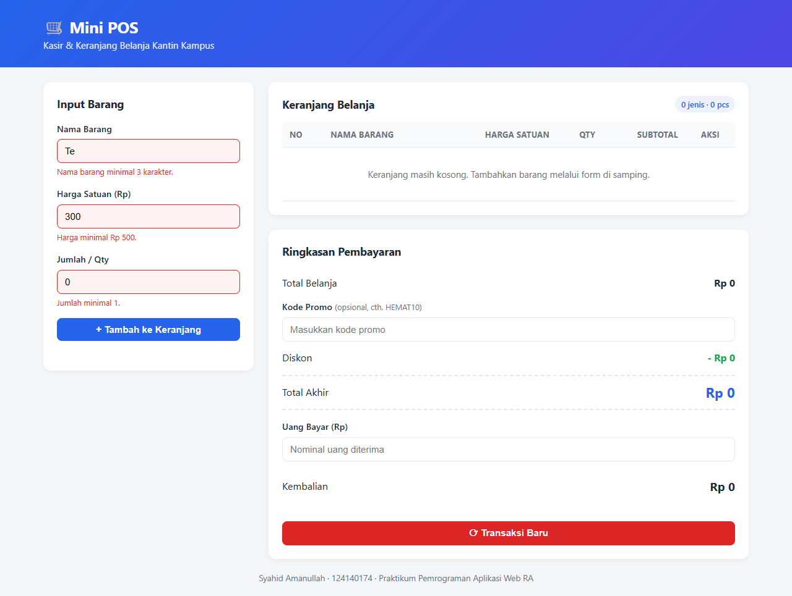
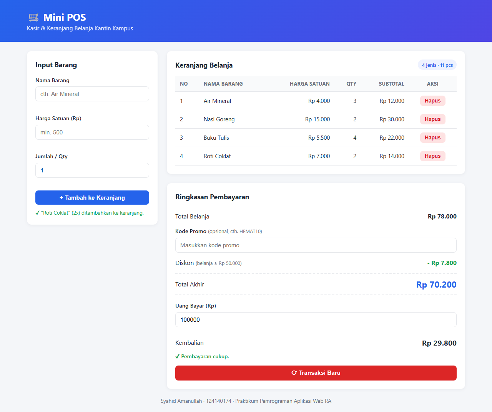
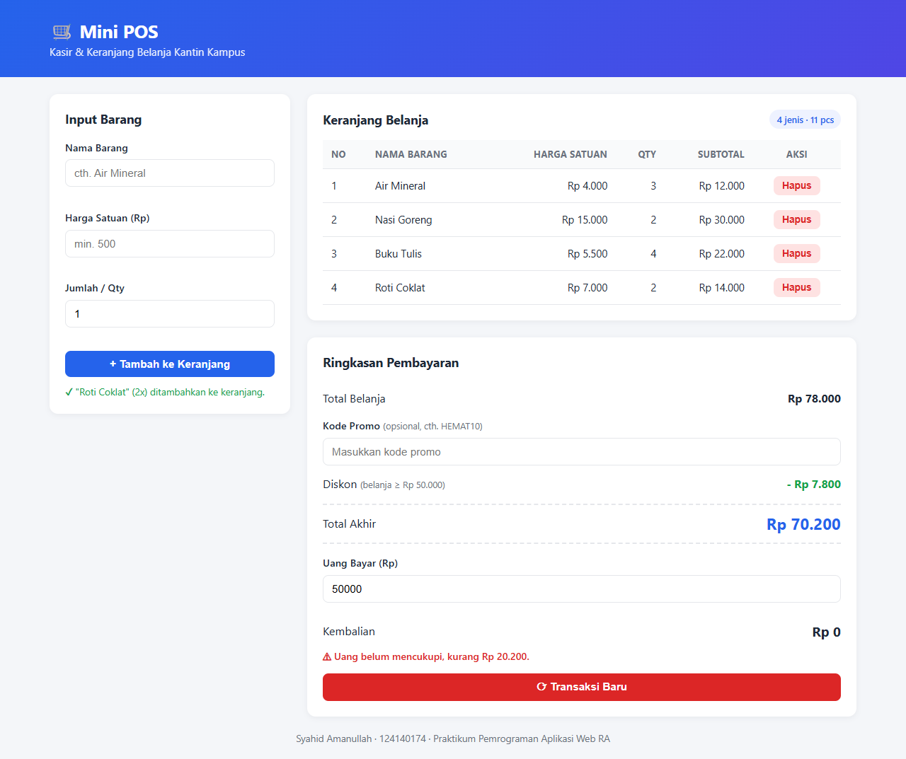
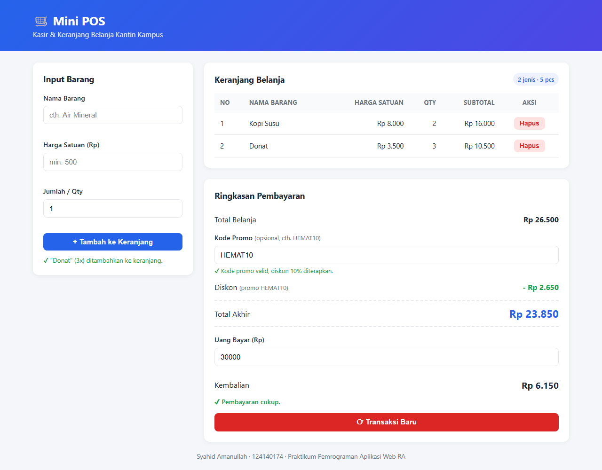
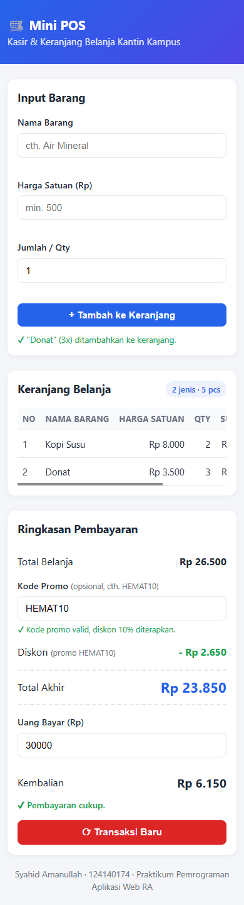

# 🛒 Mini POS — Kasir & Keranjang Belanja Sederhana

Tugas Praktikum Pemrograman Aplikasi Web — Pertemuan 1

## 👤 Identitas

| | |
|---|---|
| **Nama Lengkap** | Syahid Amanullah |
| **NIM** | 124140174 |
| **Kelas Praktikum** | RA |

---

## 📖 Deskripsi Aplikasi

**Mini POS** adalah aplikasi web kasir sederhana untuk kantin/toko kampus. Kasir dapat memasukkan barang yang dibeli pelanggan, melihat daftar belanja dalam bentuk tabel, menghitung total belanja beserta diskon secara otomatis, hingga menghitung uang kembalian.

**Tujuan pembuatan:** menerapkan tiga kompetensi dasar JavaScript di sisi klien dalam satu studi kasus utuh:

1. **Validasi input form** — mencegah data barang yang tidak valid masuk ke keranjang.
2. **Kalkulator otomatis** — subtotal, total, diskon, total akhir, dan kembalian.
3. **Manajemen list + localStorage** — keranjang tetap tersimpan walaupun halaman di-refresh.

**Studi kasus:** Kasir & Keranjang Belanja (Mini POS) kantin kampus.

Aplikasi dibuat murni dengan **HTML, CSS, dan JavaScript (vanilla)** tanpa library/framework tambahan.

---

## 🚀 Panduan Menjalankan

**Cara 1 — Live Server (VS Code, direkomendasikan)**
1. Clone / download repository ini.
2. Buka folder `syahidamanullah_124140174_pertemuan1` di VS Code.
3. Install ekstensi **Live Server** (Ritwick Dey) jika belum ada.
4. Klik kanan `index.html` → **Open with Live Server**.
5. Aplikasi terbuka otomatis di browser (`http://127.0.0.1:5500`).

**Cara 2 — Buka langsung**
- Double-click file `index.html`, aplikasi akan terbuka di browser default.

---

## ✅ Daftar Fitur

### Validasi Form Input Barang
- [x] Nama barang wajib diisi, minimal 3 karakter (spasi di awal/akhir diabaikan)
- [x] Harga satuan wajib angka positif, minimal Rp 500
- [x] Qty wajib bilangan bulat, minimal 1
- [x] Pesan error berwarna merah di bawah input yang salah + border input ikut merah
- [x] Barang tidak masuk keranjang jika ada input yang tidak valid
- [x] Pesan error otomatis hilang saat input diperbaiki
- [x] Form otomatis di-reset + muncul notifikasi sukses jika barang berhasil ditambahkan

### Kalkulator & Perhitungan Otomatis
- [x] Subtotal per baris = Harga Satuan × Qty
- [x] Total belanja = jumlah seluruh subtotal
- [x] Diskon otomatis 10% jika total belanja ≥ Rp 50.000
- [x] Kode promo `HEMAT10` (diskon 10% walaupun belanja < Rp 50.000, tidak dobel)
- [x] Info "belanja Rp X lagi untuk dapat diskon" & validasi kode promo
- [x] Tampilan nominal diskon dan total akhir
- [x] Kalkulator kembalian = Uang Bayar − Total Akhir (real-time saat mengetik)
- [x] Keterangan "Uang belum mencukupi, kurang Rp X" jika uang kurang
- [x] Semua nominal diformat Rupiah (`Rp 15.000`)

### Manajemen Keranjang & LocalStorage
- [x] Tabel keranjang (No, Nama Barang, Harga Satuan, Qty, Subtotal, Aksi)
- [x] Tombol **Hapus** per baris, total & diskon langsung dihitung ulang
- [x] Barang yang sama (nama & harga sama) otomatis digabung qty-nya
- [x] Keranjang disimpan ke localStorage (`JSON.stringify`) & dimuat ulang (`JSON.parse`)
- [x] Tombol **Transaksi Baru** untuk mengosongkan keranjang & membersihkan localStorage (dengan konfirmasi)

### UI/UX
- [x] Layout 2 kolom di desktop, 1 kolom di HP (responsif)
- [x] Tabel bisa di-scroll horizontal di layar kecil
- [x] Angka rata kanan dengan `tabular-nums` agar mudah dibaca

---

## 📸 Tangkapan Layar

### 1. Tampilan Form Input Utama


### 2. Validasi Error
Pesan merah muncul di bawah setiap input yang tidak valid, dan barang tidak masuk ke keranjang.


### 3. Tabel Keranjang + Hasil Kalkulator
Total Rp 78.000 ≥ Rp 50.000 → diskon otomatis 10%. Uang bayar Rp 100.000 → kembalian Rp 29.800.


### 4. Uang Belum Mencukupi


### 5. Kode Promo HEMAT10
Total belanja di bawah Rp 50.000, tetapi kode promo memberikan diskon 10%.


### 6. Tampilan Mobile (Responsif)


---

## 🧠 Penjelasan Teknis

Struktur file:

```
syahidamanullah_124140174_pertemuan1/
├── index.html      → struktur halaman (form, tabel, panel pembayaran)
├── style.css       → styling + media query responsif
├── script.js       → seluruh logika aplikasi
├── README.md       → dokumentasi
├── screenshots/    → gambar untuk README
└── modul/          → file latihan selama praktikum
```

### 1. Penanganan Validasi Input

Setiap input punya fungsi validator sendiri yang mengembalikan **pesan error** (string), atau string kosong jika valid:

```js
function validatePrice(value) {
  if (value.trim() === "") return "Harga satuan wajib diisi.";
  const price = Number(value);
  if (Number.isNaN(price)) return "Harga harus berupa angka.";
  if (price <= 0) return "Harga harus bernilai positif.";
  if (price < MIN_PRICE) return `Harga minimal ${formatRupiah(MIN_PRICE)}.`;
  return "";
}
```

`validateForm()` menjalankan ketiga validator (`validateName`, `validatePrice`, `validateQty`). Jika ada pesan, `showError()` menulis pesan ke elemen `<small class="error">` di bawah input dan memberi class `invalid` (border merah). Fungsi ini mengembalikan `false` sehingga `handleFormSubmit()` berhenti dan barang **tidak** ditambahkan. Jika semua valid, barang ditambahkan lalu form di-reset dengan `itemForm.reset()`.

Form memakai atribut `novalidate` supaya validasi bawaan browser tidak muncul dan seluruh validasi ditangani oleh JavaScript.

### 2. Algoritma Kalkulator Keuangan

```
subtotal     = harga × qty                          → calculateSubtotal()
total        = Σ subtotal  (Array.reduce)           → calculateTotal()
diskon       = 10% × total, jika total ≥ 50.000     → calculateDiscount()
               ATAU kode promo == "HEMAT10"
total akhir  = total − diskon
kembalian    = uang bayar − total akhir             → calculateChange()
               jika < 0 → "Uang belum mencukupi, kurang Rp |kembalian|"
```

Semua perhitungan dipusatkan di `updateSummary()`, yang dipanggil setiap kali:
- barang ditambah / dihapus / transaksi di-reset (lewat `refreshUI()`),
- kasir mengetik kode promo (event `input`),
- kasir mengetik uang bayar (event `input`).

Dengan begitu tampilan total, diskon, dan kembalian selalu sinkron dengan isi keranjang. Nominal ditampilkan dengan `Intl.NumberFormat("id-ID")` agar formatnya `Rp 15.000`.

### 3. Mekanisme Serialisasi localStorage

localStorage hanya bisa menyimpan **string**, sedangkan keranjang berupa **array of object**:

```js
[{ id: 1712345678901, name: "Air Mineral", price: 4000, qty: 3 }, ...]
```

- **Simpan (serialisasi):** `saveCart()` → `localStorage.setItem("miniPosCart", JSON.stringify(cart))`. Fungsi ini dipanggil setiap kali keranjang berubah (`addItem`, `deleteItem`).
- **Muat (deserialisasi):** `loadCart()` → `JSON.parse(localStorage.getItem("miniPosCart"))` dijalankan saat halaman pertama kali dibuka. Prosesnya dibungkus `try...catch` dan dicek dengan `Array.isArray()`, jadi kalau data rusak atau belum ada, keranjang dimulai dari array kosong.
- **Reset:** `resetTransaction()` mengosongkan array `cart` dan memanggil `localStorage.removeItem("miniPosCart")`.

Setiap item punya `id` unik (`Date.now()`) yang disimpan di atribut `data-id` tombol Hapus. Klik tombol ditangani dengan **event delegation** pada `<tbody>`, lalu `deleteItem(id)` memfilter item tersebut dari array.

Nama barang ditampilkan lewat `escapeHTML()` sebelum dimasukkan ke `innerHTML` untuk mencegah XSS.
